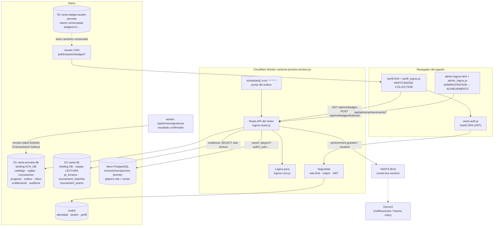
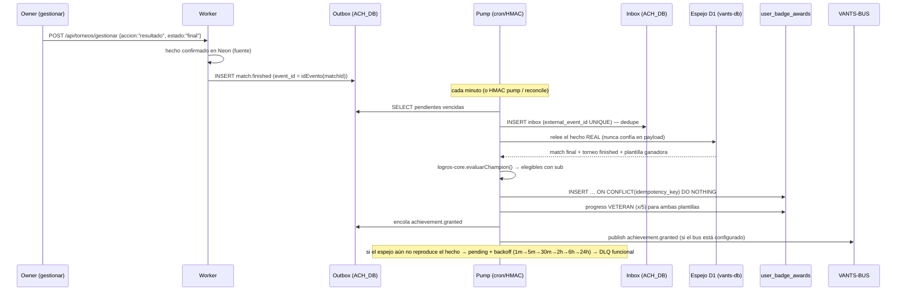

# ARCHITECTURE — VANTS ACHIEVEMENTS & BADGE ENGINE

> Decisión completa de arquitectura en [`DECISIONS.md`](./DECISIONS.md).
> Este documento describe los componentes implementados y cómo interactúan.

## Diagrama de componentes

## Flujo de una concesión automática (caso CHAMPION)

## Módulos

| Archivo | Responsabilidad | Dependencias |
|---|---|---|
| `vants-server/logros-core.js` | Lógica PURA: catálogo, idempotencia, reglas (CHAMPION/VETERAN), backoff, validaciones, HMAC, proyecciones públicas sin PII | ninguna (testeable con `node --test`) |
| `vants-server/logros-motor.js` | Ejecución sobre D1: API, outbox/inbox, pump, concesión/revocación, auditoría | logros-core |
| `vants-server/worker.js` (integración) | Dispatch de rutas + encolado en `gestionar` + `scheduled()` cron | logros-motor |
| `vants-server/db/logros/0001_logros_inicial.sql` | Esquema + catálogo semilla de 12 insignias + 12 reglas | — |
| `public/static/js/perfil_logros.js` | Colección del jugador: grid, destacadas (3), progreso, animación de desbloqueo | API del motor + Auth0 |
| `public/static/js/admin_logros.js` | Panel admin: catálogo, reglas, jugadores, procesamiento, recursos | API admin + Auth0 |
| `public/assets/badges/*` + `badge-manifest.json` | 12 insignias PNG/WebP en 6 tamaños + manifiesto con checksums | — |

## Rutas API (todas con rate-limit y validación)

| Método | Ruta | Acceso | Qué hace |
|---|---|---|---|
| GET | `/api/badges` | público | Catálogo de insignias (60 s de caché) |
| GET | `/api/players/:id/badges` | público | Colección pública de un jugador (`id` = sub Auth0 URL-encoded) |
| GET | `/api/me/badges` | sesión | Colección propia + progreso + bloqueadas (+ asegura MEMBER) |
| GET | `/api/me/achievements` | sesión | Historial de concesiones/revocaciones |
| POST | `/api/me/badges/featured` | sesión | Hasta 3 insignias destacadas |
| POST | `/api/achievements/ingest` | HMAC | Ingesta de eventos al outbox |
| POST | `/api/achievements/pump` | HMAC u owner | Procesa el outbox ahora |
| GET | `/api/admin/achievements` | owner | Panel: catálogo+reglas+conteos+procesamiento |
| POST | `/api/admin/achievements/rules` | owner | Crear regla (nueva versión) |
| PATCH | `/api/admin/achievements/rules/:id` | owner | Editar regla (condiciones, pausa, vigencia) |
| PATCH | `/api/admin/achievements/badges/:code` | owner | Activar/pausar, descripción, orden |
| POST | `/api/admin/achievements/grant` | owner | Concesión manual justificada |
| POST | `/api/admin/achievements/revoke` | owner | Revocación justificada (historial intacto) |
| POST | `/api/admin/achievements/reconcile` | owner | Re-encola DLQ + redescubre finales sin evento + pump |
| GET | `/api/admin/achievements/events` | owner | Estado de outbox/inbox/DLQ/auditoría |

Degradación: si el worker no tiene `ACH_DB` (producción `vants`), todo responde
`503 logros_no_config` y el resto del sitio funciona igual.
