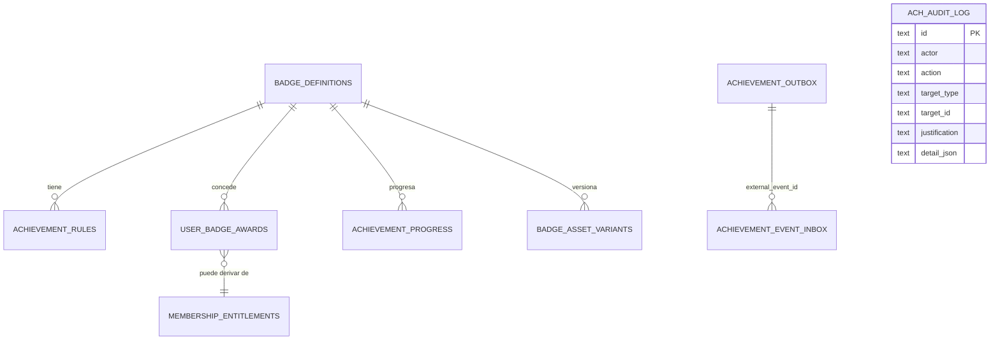

# DATABASE — Modelo de datos del motor de logros

Base: **D1 `vants-preview-db`** (binding `ACH_DB`) — migración
[`vants-server/db/logros/0001_logros_inicial.sql`](../../vants-server/db/logros/0001_logros_inicial.sql),
idempotente y re-ejecutable. Producción (`vants-db`) NO se migra ni se escribe.

## Diagrama entidad-relación

## Tablas

### badge_definitions — catálogo maestro
| Columna | Tipo | Notas |
|---|---|---|
| id | TEXT PK | `bgd_*` |
| code | TEXT UNIQUE | `CHAMPION`, `TOP 10`, … (los nombres los renderiza HTML, nunca el PNG) |
| category | CHECK | `membership` / `competitive` / `identity` |
| rarity | CHECK | `common` / `rare` / `epic` / `legendary` / `mythic` |
| grant_type | CHECK | `auto_registry` / `subscription` / `admin` / `automatic_rule` / `founder_list` |
| image_key, image_version | TEXT, INT | referencia al recurso (`badges/<code>/1024.png`) |
| is_active, display_order | INT | pausa y orden editable desde admin |

### achievement_rules — reglas versionadas
`badge_id` FK · `version` INT (creciente) · `rule_type` CHECK
(`event`/`threshold`/`admin`/`subscription`/`founder_list`/`dormant`) ·
`conditions_json` (≤4000 bytes, validado) · `source_event` · `is_active` ·
`valid_from`/`valid_until`. La concesión copia `rule_version` → auditoría de
"qué condiciones estaban vigentes cuando se concedió".

### user_badge_awards — concesión definitiva (historial inmutable)
| Columna | Notas |
|---|---|
| user_id | **sub de Auth0** (identidad canónica, DECISIONS §D1) |
| status | `active` / `revoked` / `expired` — la revocación NO borra |
| evidence_json | evidencia verificada (torneo, marcador, fecha) |
| source_event_id, rule_version | trazabilidad al hecho y a la regla |
| idempotency_key | **UNIQUE** = `sha256(user|badge|evento|periodo)` → un evento 10× = 1 concesión |
| featured_order | 1..3 · índice único parcial `(user_id, featured_order) WHERE NOT NULL` → máx. 3 destacadas |

### achievement_progress
UNIQUE `(user_id, badge_id)` · `current_value`/`target_value`/`progress_percent`
· `status` `in_progress`/`completed`/`blocked` · `last_evaluated_at`.
Se actualiza al procesar eventos (p. ej. VETERAN 1/5 = 20%).

### achievement_event_inbox — procesado único por evento
`external_event_id` **UNIQUE** + `payload_hash` + `processing_status`
(`pending/processing/processed/failed`) + `attempts` + `error_message`.

### achievement_outbox — Transactional Outbox
`event_id` **UNIQUE** (idempotencia de encolado) · `status`
(`pending/processing/done/error`) · `attempts` · `next_retry_at` (backoff
exponencial 1 m→5 m→30 m→2 h→6 h→24 h, máx. 10). `status='error'` = **DLQ
funcional** reprocesable desde admin (Queues requiere plan de pago).

### badge_asset_variants
UNIQUE `(badge_id, version, format, size)` · `storage_key` · `checksum`
(sha256) · `width/height`. Registro de cada archivo gráfico publicado.

### membership_entitlements — la base es la autoridad
UNIQUE `(user_id, tier)` · `status` (`active/expired/cancelled/refunded`) ·
`provider` (`none/stripe/paypal/manual`) — **mientras no haya proveedor de
pagos, no existen filas con derechos reales y los badges de suscripción
permanecen dormiles** (no se fingen).

### ach_audit_log — auditoría
Toda operación de escritura (motor, admin, reconciliación): `actor`,
`action`, `target`, `justification`, `detail_json`, índices por fecha y acción.

## Restricciones clave (verificadas por pruebas)
1. `user_badge_awards.idempotency_key` UNIQUE → el caso "pago/evento duplicado
   no genera dos insignias" se garantiza en la base, no solo en código.
2. `uq_awards_destacada` parcial → nunca más de 3 destacadas por usuario.
3. `achievement_event_inbox.external_event_id` UNIQUE → procesado único.
4. `achievement_outbox.event_id` UNIQUE → encolado único (re-encolar no duplica).
5. CHECKs de estados y tipos → estados inválidos imposibles.
